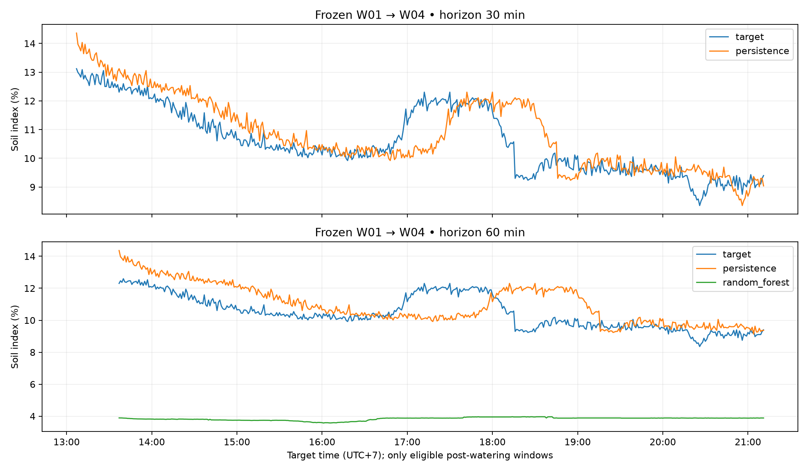

# Đánh giá W01 đóng băng trên W04

**W04 đã xử lý xong với giới hạn nhật ký được công bố. Random Forest W01 chưa tổng quát tốt sang chu kỳ tưới W04; không phê duyệt tự động tưới.**

## Phương pháp

Dùng nguyên hai `candidate.joblib` W01 (30 phút chọn Persistence; 60 phút chọn Random Forest từ validation W01), không fit lại, không chọn lại mô hình theo W04. Đánh giá thêm Persistence và Linear Extrapolation; các mô hình W01 không được lưu không được tái huấn luyện để tạo điểm kiểm định giả.

Dữ liệu thật, timestamp thiết bị UTC, bin phút đã đóng; giờ hiển thị UTC+7. Đòi hỏi 16 phút lịch sử liên tục và khoảng tương lai không thiếu, cùng bộ đếm sự kiện tưới. Không có cửa sổ nào đi qua hai lần tưới. Đoạn giữa hai lần tưới quá ngắn để tạo cửa sổ dự báo hợp lệ. Giữ cách cắt dự đoán 0–100 theo pipeline W01.

Bản chính không giả định lịch sử trước W04: đánh giá các cửa sổ sau lần tưới thứ hai. Feature đầu 12:37; nhãn cuối 21:11. 485 cửa sổ 30 phút, 455 cửa sổ 60 phút. Đây là cửa sổ chồng lấn, không phải 940 thử nghiệm độc lập. MAE tính theo **điểm phần trăm chỉ số soil**, không phải sai số tương đối %.

## Kết quả chính

| Horizon | Cửa sổ | Persistence MAE | Linear Extrapolation MAE | Random Forest W01 MAE |
|---|---:|---:|---:|---:|
| 30 phút | 485 | **0,5729** | 0,9646 | Không có estimator W01 được lưu cho horizon này |
| 60 phút | 455 | **1,0045** | 1,7996 | **6,6250** |

Các cửa sổ mục tiêu giảm so với hiện tại: 336 (30 phút), 342 (60 phút). MAE tương ứng của Persistence 0,6048 / 1,0187; RF60 là 6,4495. Không chỉ báo cáo riêng các đoạn giảm để làm đẹp kết quả tổng.

Ở 60 phút, cả 455 giá trị soil hiện tại trong W04 đều ngoài khoảng fit W01: W01 khoảng 3,2963–4,8303; W04 khoảng 9,1384–14,3603. Đây là bằng chứng lệch phân bố và phù hợp với đường RF dự đoán gần 4%; không chứng minh đây là nguyên nhân duy nhất. Không thể suy ra AI đã biết nhu cầu nước của cây từ MAE này.



## Độ nhạy với nhật ký

- Nới mỗi sự kiện sớm một phút và muộn một phút: còn 484/454 cửa sổ; Persistence MAE 0,5716/1,0022; RF60 6,6211. Kết luận không đổi. Đây là kịch bản thử độ nhạy, không phải khoảng tin cậy cho giờ thực tế.
- Chỉ trong kịch bản giả định lần trước vẫn là W01 11/11 12:14: dùng được 652 phút, 544/484 cửa sổ; Persistence MAE 0,5791/1,0024, RF60 6,3166. Không dùng các số này làm kết quả chính khi thiếu xác nhận khoảng trước phiên.

## So sánh với những phiên trước

| Phiên | Persistence 30 | Persistence 60 | RF60 |
|---|---:|---:|---:|
| W01 test | 0,4805 | 0,4939 | 0,8017 |
| W02 frozen | 0,3019 | 0,4649 | 1,8523 |
| W03 frozen | 0,3286 | 0,4544 | 0,9557 |
| W04 frozen, sau tưới | 0,5729 | 1,0045 | 6,6250 |

W01 chỉ dùng tập test; W02–W04 dùng toàn bộ cửa sổ đủ điều kiện trong phiên. Phân bố và số cửa sổ khác nhau, không lấy trung bình bốn MAE để kết luận chất lượng chung. W02/W03 thuộc chu kỳ trước; W04 có chu kỳ tưới mới nhưng cùng cây, chậu, cảm biến. Chưa có thử nghiệm độc lập trên cây khác.

## Tái lập và trạng thái bàn giao

Chạy từ gốc repository bằng môi trường `.venv-ai`. Dữ liệu gốc và journal đã lưu; không cần USB hoặc database để tái chạy phần offline.

```bash
.venv-ai/bin/python tools/prepare_telemetry.py artifacts/session-w04-2026-11-14/telemetry.jsonl --output-dir /tmp/w04-recheck
.venv-ai/bin/python tools/build_ai_dataset.py artifacts/session-w04-2026-11-14/telemetry.jsonl --journal artifacts/session-w04-2026-11-14/watering-journal.json --output /tmp/w04-minute-data.csv --as-of 2026-11-14T21:12:00+07:00
.venv-ai/bin/python artifacts/session-w04-2026-11-14/verify_evidence.py
```

`evaluate_frozen.py` tạo thư mục evaluation mới và từ chối ghi đè thư mục đã có. Để đánh giá lại, dùng bản sao riêng của gói và đổi root output; giữ nguyên candidate W01. `check_sensitivity.py` ghi kết quả kịch bản phụ. CSV dự đoán chứa timestamp feature, timestamp target, giá trị thực và dự đoán để tính lại MAE.

Đã lưu báo cáo, nhật ký, dự đoán, ảnh và checksum. Gói W04 được chuẩn bị thành commit riêng theo yêu cầu push; các sửa backend/UI trong working tree không thuộc gói này. Không nâng cấp mô hình production, không triển khai backend, không bật AUTO.
