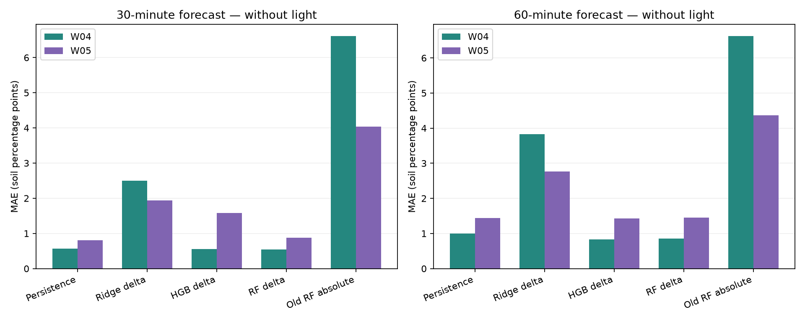

# Thí nghiệm dự đoán delta độ ẩm đất — hoàn tất 17/11/2026

**Kết luận: delta khắc phục phần lớn sai lệch mức nền của Random Forest, nhưng chưa đủ bằng chứng thay mô hình đang chạy. Persistence vẫn là lựa chọn đơn giản, ổn định theo validation đã chốt.** HGB delta 60 phút là ứng viên nghiên cứu tiếp; không chọn lại mô hình dựa trên W05.

## Thiết kế và giới hạn độc lập

- Giữ nguyên W01–W05, model cũ và báo cáo trước. Chỉ thêm module và artifacts riêng; không gọi backend, DB, Serial hay lệnh bơm. Không triển khai model và không bật AUTO. Trạng thái thiết bị đang chạy không được xác minh bằng thí nghiệm offline này.
- Fit W01; chọn siêu tham số theo trung bình MAE W02 và W03 với trọng số bằng nhau. Không fit lại sau validation. W04/W05 chỉ được đọc ở lệnh evaluate, sau khi lưu frozen.json và các model.
- W01–W03 cùng chu kỳ C1. W04–W05 thuộc chu kỳ C2 sau tưới W04. Không có chu kỳ độc lập thứ ba để chọn model. W05 là holdout theo thời gian trong C2, **không phải một chu kỳ độc lập với W04**.
- Kết quả mô hình tuyệt đối trên W05 đã được xem trước khi đề xuất hướng delta. Vì vậy đây không phải kiểm định hoàn toàn mù. Trong thí nghiệm delta này, không dùng W05 để fit/chọn siêu tham số; muốn xác nhận cuối cùng cần phiên tương lai chưa quan sát.
- Target = soil_future − soil_current; dự báo = clip(soil_current + delta, 0, 100). Không ép delta âm: cảm biến có thể tăng dù không có sự kiện tưới được ghi nhận.
- Hai bộ đặc trưng dùng cùng cửa sổ hợp lệ; 16 phút lịch sử liên tục, đầy đủ dữ liệu đến nhãn và không tưới trong khoảng dự báo. Không nối lag qua phiên. Toàn bộ khoảng lịch sử–nhãn giữa fit/validation/test không chồng lấn. Cửa sổ trong mỗi phiên vẫn chồng lấn, không phải các phép thử độc lập.
- Bộ cũ gồm soil hiện tại, lag 5/15, slope 15, nhiệt độ, độ ẩm khí, thời gian từ lần tưới, sin/cos giờ. Bộ sáng thêm ADC hiện tại/lag 5/15/mean 15/slope 15. Không dùng ánh sáng tương lai, không đổi ADC thành lux. Bão hòa 4095 được giữ và có phân tích nhạy cảm riêng.
- Ridge có StandardScaler fit chỉ trên W01; alpha ∈ {1,10,100}. HGB 100 iterations, learning_rate=0.05, min_samples_leaf=20, L2=10, max_leaf_nodes ∈ {3,7}, early_stopping=False (không có validation random nội bộ). RF 150 cây, min_samples_leaf=20, depth ∈ {3,6}. Seed=42. Không tìm thêm cấu hình sau khi nhìn W04/W05.

## Kết quả MAE trên cùng cửa sổ

MAE tính bằng **điểm phần trăm chỉ số soil đã hiệu chuẩn**, không phải % sai số tương đối hay độ ẩm thể tích đất. W04: 485/455 cửa sổ; W05: 418/388 cửa sổ ở 30/60 phút.

| Mô hình | W04 30 phút | W04 60 phút | W05 30 phút | W05 60 phút |
|---|---:|---:|---:|---:|
| Persistence | 0.5729 | 1.0045 | 0.8034 | 1.4411 |
| Ridge Δ, không sáng | 2.5018 | 3.8340 | 1.9429 | 2.7703 |
| Ridge Δ, có sáng | 2.8138 | 3.9750 | 3.0201 | 3.2141 |
| HGB Δ, không sáng | 0.5578 | 0.8334 | 1.5816 | 1.4329 |
| HGB Δ, có sáng | 0.6065 | 0.8297 | 1.6066 | 1.4223 |
| RF Δ, không sáng | 0.5484 | 0.8555 | 0.8794 | 1.4529 |
| RF Δ, có sáng | 0.5361 | 0.8573 | 0.9001 | 1.4520 |
| RF tuyệt đối cũ, không sáng | 6.6132 | 6.6246 | 4.0367 | 4.3649 |
| RF tuyệt đối cũ, có sáng | 6.6114 | 6.6119 | 4.0256 | 4.2872 |

RF tuyệt đối trong bảng là model control/light của thí nghiệm ánh sáng W01-fit đóng băng, được dự đoán lại trên đúng các hàng này. Bản candidate W01 ban đầu báo MAE W04 60 phút khoảng 6,625; nguồn/bundle khác được giữ nguyên, không đánh đồng lịch sử lựa chọn model.

### Lựa chọn trước khi mở holdout

| Mô hình | Validation 30 | Validation 60 |
|---|---:|---:|
| Persistence | 0.3153 | 0.4596 |
| Ridge Δ, không sáng | 0.8041 | 0.6939 |
| Ridge Δ, có sáng | 1.4672 | 0.9506 |
| HGB Δ, không sáng | 1.3700 | 0.7343 |
| HGB Δ, có sáng | 1.3701 | 0.7002 |
| RF Δ, không sáng | 0.6277 | 0.7427 |
| RF Δ, có sáng | 0.6504 | 0.7484 |

Persistence thắng validation ở cả hai horizon. HGB-light 60 giảm MAE W05 từ 1,4411 xuống 1,4223 (khoảng 1,3%), nhưng 30 phút kém đáng kể; mức cải thiện nhỏ trên một chu kỳ chưa chứng minh ổn định. Không có kiểm định thống kê độc lập theo chu kỳ vì chỉ có một chu kỳ test.

## Vì sao Random Forest cũ sai cao?

RF hồi quy target tuyệt đối dự đoán bằng trung bình nhãn trong lá/cây, không ngoại suy ra ngoài khoảng nhãn train. W04 có toàn bộ mức soil cao hơn miền W01; RF vì vậy giữ dự đoán quanh mức thấp của W01 và liên tục đánh giá thiếu. Delta đặt lại mốc dự báo tại giá trị soil hiện tại nên không bị mắc kẹt vào mức soil tuyệt đối của train. Đây là giải thích phù hợp với số liệu, không chứng minh mọi sai số đều do một nguyên nhân.

| Phiên / horizon | Soil train | Soil test | Soil ngoài train | Delta ngoài train | Thời gian từ tưới ngoài train | ADC ngoài train |
|---|---|---|---:|---:|---:|---:|
| W04/30 | 3.264–5.189 | 8.355–14.360 | 100.0% | 8.5% | 0.4% | 0.0% |
| W05/30 | 3.264–5.189 | 3.721–10.933 | 66.7% | 7.7% | 100.0% | 54.8% |
| W04/60 | 3.264–5.026 | 9.138–14.360 | 100.0% | 17.1% | 0.4% | 0.0% |
| W05/60 | 3.264–5.026 | 3.721–10.933 | 71.6% | 22.2% | 100.0% | 59.0% |

W05 còn lệch mạnh về tuổi chu kỳ: 1.452–1.869 phút sau tưới, trong khi fit chỉ 17–499 phút (30 phút). Hơn nửa ADC W05 nằm ngoài miền train. Ridge vẫn ngoại suy kém; cây delta vẫn bị giới hạn miền delta đã học. W05 có mức tăng soil tới khoảng 6,2 điểm trong 60 phút dù nhật ký không ghi tưới thêm; không tự sửa nhãn hay kết luận có tưới. Cần kiểm tra biến thiên cảm biến/điều kiện môi trường ở phiên tương lai.

## Ảnh hưởng ánh sáng

Không có lợi ích nhất quán. W05 RF delta có sáng kém hơn không sáng ở 30 phút (0,9001 so với 0,8794), gần như ngang nhau ở 60 phút. HGB có sáng cải thiện rất nhỏ ở 60 phút nhưng kém ở 30 phút; Ridge thêm sáng kém hơn cả hai horizon. Vì cấu hình mỗi bộ được chọn riêng trên validation, so sánh phản ánh pipeline có/không sáng, không phải ước lượng nhân quả của ánh sáng.

## Sai số theo khoảng soil hiện tại

Các khoảng [0,5), [5,10), [10,20), [20,40), [40,60), [60,100] được định trước; khoảng trống không có bằng chứng. Bảng chi tiết đủ mọi model trong JSON; dưới đây là Persistence và toàn bộ model delta.

### W04, 30 phút

| Soil hiện tại | n | Persistence | Ridge | Ridge sáng | HGB | HGB sáng | RF Δ | RF Δ sáng |
|---|---:|---:|---:|---:|---:|---:|---:|---:|
| [0,5) | 0 | — | — | — | — | — | — | — |
| [5,10) | 142 | 0.3195 | 2.2632 | 2.7915 | 0.5527 | 0.6775 | 0.4529 | 0.4564 |
| [10,20) | 343 | 0.6779 | 2.6005 | 2.8230 | 0.5599 | 0.5771 | 0.5879 | 0.5691 |
| [20,40) | 0 | — | — | — | — | — | — | — |
| [40,60) | 0 | — | — | — | — | — | — | — |
| [60,100] | 0 | — | — | — | — | — | — | — |

### W05, 30 phút

| Soil hiện tại | n | Persistence | Ridge | Ridge sáng | HGB | HGB sáng | RF Δ | RF Δ sáng |
|---|---:|---:|---:|---:|---:|---:|---:|---:|
| [0,5) | 103 | 1.8695 | 1.9903 | 3.2259 | 2.6088 | 2.6177 | 1.9129 | 1.9341 |
| [5,10) | 221 | 0.3688 | 1.8014 | 2.8992 | 1.3056 | 1.3347 | 0.4643 | 0.4854 |
| [10,20) | 94 | 0.6569 | 2.2239 | 3.0788 | 1.1049 | 1.1379 | 0.7230 | 0.7420 |
| [20,40) | 0 | — | — | — | — | — | — | — |
| [40,60) | 0 | — | — | — | — | — | — | — |
| [60,100] | 0 | — | — | — | — | — | — | — |

### W04, 60 phút

| Soil hiện tại | n | Persistence | Ridge | Ridge sáng | HGB | HGB sáng | RF Δ | RF Δ sáng |
|---|---:|---:|---:|---:|---:|---:|---:|---:|
| [0,5) | 0 | — | — | — | — | — | — | — |
| [5,10) | 112 | 0.4257 | 3.4829 | 3.7286 | 0.5655 | 0.5562 | 0.4444 | 0.4502 |
| [10,20) | 343 | 1.1935 | 3.9486 | 4.0555 | 0.9208 | 0.9191 | 0.9898 | 0.9902 |
| [20,40) | 0 | — | — | — | — | — | — | — |
| [40,60) | 0 | — | — | — | — | — | — | — |
| [60,100] | 0 | — | — | — | — | — | — | — |

### W05, 60 phút

| Soil hiện tại | n | Persistence | Ridge | Ridge sáng | HGB | HGB sáng | RF Δ | RF Δ sáng |
|---|---:|---:|---:|---:|---:|---:|---:|---:|
| [0,5) | 103 | 3.3499 | 3.3810 | 3.8558 | 3.2018 | 3.1822 | 3.4080 | 3.4176 |
| [5,10) | 191 | 0.4658 | 2.5244 | 2.9830 | 0.5548 | 0.5399 | 0.4986 | 0.4903 |
| [10,20) | 94 | 1.3312 | 2.6005 | 2.9807 | 1.2790 | 1.2870 | 1.2495 | 1.2524 |
| [20,40) | 0 | — | — | — | — | — | — | — |
| [40,60) | 0 | — | — | — | — | — | — | — |
| [60,100] | 0 | — | — | — | — | — | — | — |

## Độ nhạy và độ tin cậy

Chọn các cửa sổ không chồng lấn toàn bộ lịch sử–nhãn, bắt đầu từ hàng hợp lệ đầu tiên, cách nhau ít nhất horizon+16 phút. Chỉ còn 6–11 điểm mỗi phiên/horizon; đây là kiểm tra mô tả, không phải khoảng tin cậy hay xác nhận trên nhiều chu kỳ.

| Phiên/horizon | n không chồng lấn | Persistence | RF Δ không sáng | HGB Δ có sáng | n không ADC bão hòa |
|---|---:|---:|---:|---:|---:|
| W04/30 | 11 | 0.6409 | 0.5514 | 0.5760 | 394 |
| W05/30 | 10 | 0.4275 | 0.4905 | 1.1741 | 375 |
| W04/60 | 6 | 1.3055 | 1.1407 | 1.0922 | 383 |
| W05/60 | 6 | 1.7189 | 1.5999 | 1.5815 | 356 |

Điểm không chồng lấn khác đáng kể điểm toàn bộ cửa sổ, cho thấy kết luận phụ thuộc vị trí lấy mẫu và diễn biến từng phiên. Không tăng độ tin cậy giả bằng cách coi hàng trăm cửa sổ là hàng trăm chu kỳ.

## Đề xuất sử dụng thực tế

1. Dùng Persistence làm chuẩn dự báo/ứng viên đơn giản ở cả 30/60 phút; đây là đề xuất, **chưa thay production**. Persistence dự báo soil giữ nguyên, không xác định cây cần bao nhiêu nước.
2. Giữ RF delta và HGB delta ở chế độ nghiên cứu. Ưu tiên xác nhận HGB 60 phút và RF delta 30 phút trên chu kỳ mới đã khóa trước, không tự chọn model thắng W05 làm model production.
3. Thu thêm các chu kỳ tưới tự nhiên với lượng nước đo và thời điểm chính xác, đủ các giai đoạn sau tưới/khô dần; giữ cảm biến cố định. Không tưới chỉ để tăng số mẫu. Khóa cấu hình trước phiên test tương lai.
4. Khi đủ nhiều chu kỳ, chọn siêu tham số bằng forward validation theo chu kỳ. Nếu dùng W04/W05 cho lần train tiếp theo, đánh dấu chúng là development và giữ chu kỳ tương lai làm test mới.
5. Không dùng dự báo khi thiếu lịch sử hợp lệ, có tưới trong bài toán cần dự báo, thay calibration hoặc ngoài phạm vi chưa được kiểm chứng. Chưa có bằng chứng cho cây/chậu khác. AI không được cấp quyền bơm.

## File bàn giao và tái lập

- Code: `ai/smart_green_ai/delta_experiment.py`; tests: `ai/tests/test_delta_experiment.py`.
- Model delta: `artifacts/delta-experiment-20261116/horizon-{30,60}/*.joblib` (12 bundle, riêng biệt với production).
- Protocol/validation/hash: `artifacts/delta-experiment-20261116/frozen.json`; được lưu trước đánh giá W05. SHA256: `5fc114952001f3682fb66985d4a4a89ee212d5356970c431f3a027bbe772dc49`.
- Kết quả/predictions: `artifacts/delta-experiment-20261116/evaluation/`; JSON dùng trực tiếp tại thư mục artifacts này; biểu đồ và manifest đối chiếu ở `docs/evidence/delta-20261117/` (không lưu JSON trùng).
- Artifacts đặt tên theo ngày bắt đầu 16/11; báo cáo hoàn tất 17/11. Không ghi đè output cũ. Model joblib chỉ load từ nguồn tin cậy. Môi trường/version được ghi trong frozen.json.

```bash
PYTHONPATH=ai OMP_NUM_THREADS=1 OPENBLAS_NUM_THREADS=1 .venv-ai/bin/python -m smart_green_ai.delta_experiment fit \
  --data-dir artifacts/light-experiment-20261115 --output artifacts/delta-rerun
PYTHONPATH=ai OMP_NUM_THREADS=1 OPENBLAS_NUM_THREADS=1 .venv-ai/bin/python -m smart_green_ai.delta_experiment evaluate \
  --frozen-dir artifacts/delta-rerun \
  --w04 artifacts/light-experiment-20261115/W04-minutes.csv \
  --w05 datasets/w05/light-minutes.csv \
  --old-models artifacts/light-experiment-20261115 --output artifacts/delta-rerun/evaluation
PYTHONPATH=ai .venv-ai/bin/python -m pytest ai/tests -q
```

Chạy từ gốc repository, với các artifacts W01–W04/light đã có. Chỉ code không đủ tái lập nếu thiếu các đầu vào này. Gói W05 đã chọn lọc vẫn được giữ nguyên. Không yêu cầu USB hay backend đang chạy.

## Kiểm tra hoàn tất

- 34 tests AI đạt, gồm công thức delta/clipping, không đọc đặc trưng tương lai, loại cửa sổ có tưới, embargo toàn bộ lịch sử–nhãn, phase fit không đọc W04/W05, phase evaluate không được fit, kiểm tra bundle bị sửa và từ chối ghi đè.
- Chạy lại fit/evaluate độc lập vào thư mục `/tmp`: validation giống hệt, cả bốn CSV dự đoán W04/W05 khớp từng byte.
- Kiểm tra lại manifests W01 (35 file), W02 (19), W03 (33), W04 (40); tái dựng nhãn/MAE W04 và xác minh candidate cũ không đổi: đạt.
- Gói W05: checksum, 927 mẫu, dữ liệu phút và MAE trước đây vẫn đạt. Không sửa dữ liệu gốc hay báo cáo W01–W05.
- Manifest của thí nghiệm mới nằm ở `artifacts/delta-experiment-20261116/manifest.json`; manifest code/test/báo cáo bằng chứng nằm ở `docs/evidence/delta-20261117/manifest.json`.



## Đối chiếu yêu cầu bàn giao TV1

| Yêu cầu | Trạng thái / bằng chứng |
|---|---|
| Giữ dữ liệu gốc W01–W05 và mô hình cũ | Đạt: kiểm tra manifest và candidate cũ; chỉ thêm file mới |
| Dự đoán ΔSoil, tái dựng soil tương lai | Đạt: delta_target / predict_delta, test công thức và clipping |
| Ridge, HistGradientBoosting, Random Forest | Đạt: 12 bundle (3 họ × 2 bộ đặc trưng × 2 horizon) |
| Có/không ánh sáng, Persistence | Đạt: cùng cửa sổ kiểm thử, bảng MAE đầy đủ ở trên |
| Chia chu kỳ, tránh rò rỉ | Fit/validation thuộc C1; test W04/W05 thuộc C2; không random split, có embargo lịch sử–nhãn. Validation W02/W03 chưa phải chu kỳ độc lập |
| W05 không fit/chọn siêu tham số | Đạt cho thí nghiệm delta: fit chỉ đọc W01–W03; lựa chọn được lưu trước evaluate. W05 đã được xem trong thí nghiệm cũ nên không tuyên bố kiểm định hoàn toàn mù |
| Báo cáo MAE 30/60 | Đạt: báo cáo, JSON chi tiết, bốn CSV dự đoán và biểu đồ |
| Không tự thay model đang chạy | Đạt: promote=false; bundle riêng, không sửa inference/backend |
| Không sửa phần cứng/Dashboard/điều khiển bơm | Đạt: chỉ thêm module AI offline, tests và tài liệu/artifacts |
| Kiểm thử và bàn giao Git | 34 tests AI đạt; manifest W01–W05 đạt. Source, báo cáo và artifacts delta được chuẩn bị trên nhánh tv1/firmware-ai-foundation; trạng thái push thông báo riêng theo kết quả Git thực tế |

**Hoàn thành phạm vi thí nghiệm yêu cầu. Chưa hoàn thành mục tiêu chứng minh model mới thắng baseline ổn định trên nhiều chu kỳ; không dùng việc đã chạy thí nghiệm để tuyên bố AI đã sẵn sàng điều khiển tưới.**
