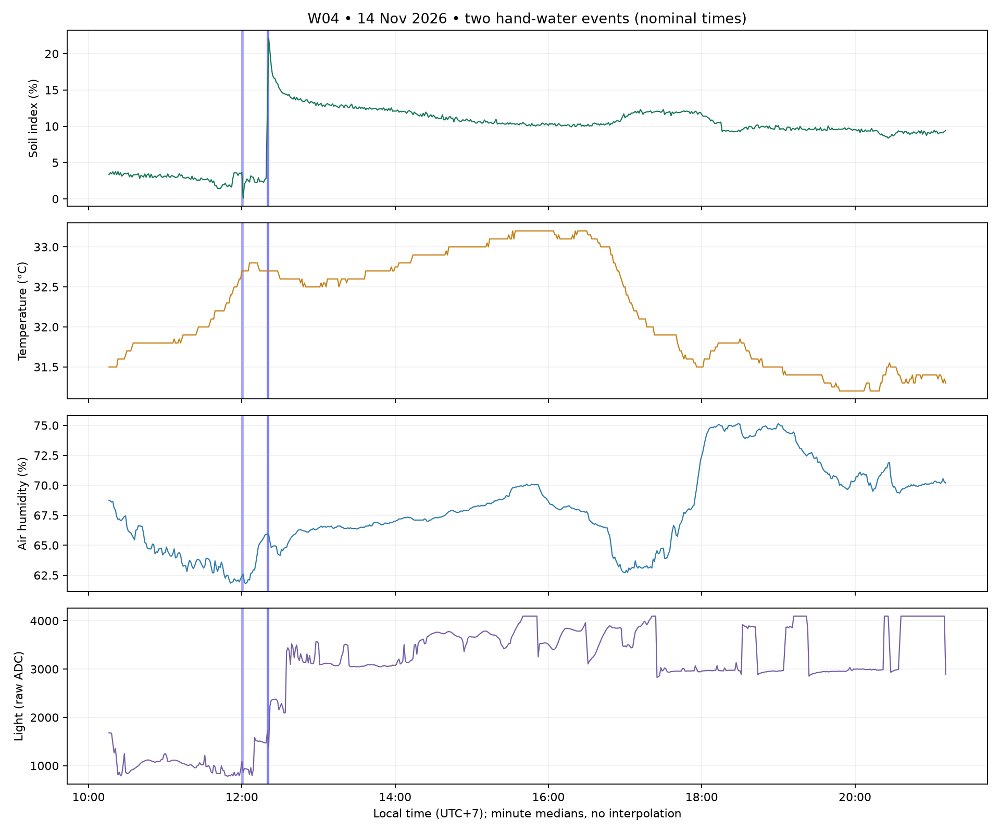

# W04 — phiên thu thực tế ngày 14/11/2026

Đã hoàn thành xuất dữ liệu, kiểm tra chất lượng và đánh giá offline mô hình W01 đóng băng. Không cập nhật database, không gửi lệnh bơm, không triển khai bản backend đang chờ.

## Phạm vi và dữ liệu gốc

- Thiết bị `garden-01`, nguồn `real`, hiệu chuẩn `soil-2511-979`, cùng cây cẩm nhung/chậu 9 cm của W01–W03.
- Lọc theo `received_at` từ 10:15:00 đến 21:12:00 ngày 14/11 (UTC+7), bao gồm hai đầu theo bàn giao.
- **1.313 mẫu**, nhận từ **10:15:44.998300 đến 21:11:45.785317**. Không có sự kiện bơm trong bảng `watering_events` ở phạm vi này.
- Bản gốc: [database-rows.jsonl](../artifacts/session-w04-2026-11-14/database-rows.jsonl); payload có giờ nhận: [telemetry.jsonl](../artifacts/session-w04-2026-11-14/telemetry.jsonl); CSV payload chưa gộp: [W04_2026-11-14.csv](../artifacts/session-w04-2026-11-14/W04_2026-11-14.csv).
- Snapshot lấy bằng transaction PostgreSQL chỉ đọc, repeatable read. Mật khẩu/URL kết nối không nằm trong gói bàn giao.

## Nhật ký và giới hạn

| Sự kiện | Giờ ICT danh định | Lượng được báo cáo | Độ chắc chắn |
|---|---|---|---|
| W04-hand-1 | 12:00–12:01 | 2 muỗng cà phê, khoảng 10 ml | Bắt đầu gần đúng; kết thúc báo cáo theo phút |
| W04-hand-2 | 12:20–12:21 | 3 muỗng cà phê, khoảng 15 ml | Suy ra từ trao đổi/ảnh; chưa xác nhận chính xác |

Giữ hai sự kiện riêng. Ước lượng dựa trên giả định 5 ml/muỗng; `volume_ml=null`, `estimated_volume_ml=10/15`, không trình bày như phép đo bằng cốc chia vạch. Không tạo lệnh ESP32 từ nhật ký tưới tay.

Bàn giao ghi nhận không di chuyển cảm biến, không tưới thêm sau lần hai. Khoảng từ cuối W03 tới đầu W04 chưa được xác nhận lại về tưới: bản đánh giá chính giữ `last_watered_at_before_start=null` và loại phần trước lần tưới đầu khỏi AI. Phần dữ liệu này vẫn được bảo toàn và vẽ mô tả. Có phân tích phụ mang tên `prior_W01_assumption`, tuyệt đối không coi giả định là nhật ký đã xác nhận.

## Chất lượng

| Chỉ tiêu | Kết quả |
|---|---:|
| Trùng theo device/boot/sequence | 0 |
| Phiên khởi động | 1 |
| Mẫu thiếu giờ đo | 1, mẫu đầu chưa đồng bộ |
| Chu kỳ đo có timestamp | 29–31 giây; trung vị 30 giây |
| Khoảng cách đo >45 giây | 0 |
| Cờ cảm biến đất/không khí hợp lệ | 1.313/1.313 |
| Mode OFF / pump_on false | 1.313/1.313 |
| Lỗi đồng hồ / lưu trữ | 0 / 0 |
| Phao báo không đủ nước | 2 mẫu đầu |
| Soil bằng 0 | 1 mẫu, giữ nguyên bản gốc |
| Light ADC hiện diện | 1.313/1.313 |
| Light ADC bằng 4095 | 134 mẫu (10,21%) |

Có **656 phút** từ 10:16 đến 21:11 theo giờ thiết bị, không có phút trống nội bộ. Không gán giờ cho mẫu đầu và không nội suy. Bản chính có **548 phút đủ điều kiện**, loại **108 phút**: 105 phút thiếu lịch sử tưới trước phiên và 4 phút chứa tưới, trong đó một phút thuộc cả hai lý do. Phút kết thúc sự kiện cũng bị loại theo quy tắc pipeline hiện tại.

Cờ hợp lệ của firmware không chứng minh cảm biến đã chính xác tuyệt đối. `soil_pct` là chỉ số tương đối sau hiệu chuẩn, không phải phần trăm thể tích nước trong đất.

## Diễn biến đo được

Trung vị theo phút: 11:59 là 3,5248%; 12:01 giảm xuống 0,0653%; 12:05 là 2,5457%. Không suy ra lần tưới đầu không có tác dụng chỉ từ cảm biến.

Sau lần hai, 12:19 là 2,8394%; 12:21 là **22,1279%** (đỉnh trung vị phút), 12:30 là 15,0457%; cuối phiên 21:11 là 9,3995%. Giá trị mẫu đơn lớn nhất 23,04177%. Các số này khác ảnh dashboard vì dùng trung vị phút theo timestamp thiết bị.

Khoảng 16:45–17:45 có đoạn chỉ số đất tăng từ khoảng 10–10,6 lên khoảng 12%, sau đó giảm quanh 18:00–18:15. Nhật ký không ghi thêm tưới; giữ đoạn này nguyên vẹn, chưa xác định nguyên nhân. Không gán toàn bộ giảm độ ẩm cho bay hơi, không suy ra thêm sự kiện tưới bằng cách nhìn đường cong.

## Ánh sáng và công việc kế tiếp

`light_raw` đã được lưu đầy đủ, khoảng 756–4095; `light_lux` đều null đúng với trạng thái chưa hiệu chuẩn. Có 134 mẫu chạm giá trị 4095: cần kiểm tra giới hạn dải đo/bão hòa và chiều đáp ứng của mạch trước khi đặt ngưỡng cảnh báo ánh sáng. Chưa có cơ sở đổi ADC thành lux hay kết luận cây thiếu/thừa ánh sáng.

Không thay đổi bộ 9 đặc trưng của W01 trong đánh giá này. Thử thêm ánh sáng là thí nghiệm mô hình phiên bản mới: chia theo phiên/thời gian, giữ một phiên tương lai chưa sử dụng để kiểm định, so sánh có/không ánh sáng trên cùng split. Các thay đổi UI/backend và thí nghiệm này không thuộc việc triển khai trong lần xử lý W04.

Kết quả AI và so sánh: [AI_EVAL_W04_2026-11-14.md](AI_EVAL_W04_2026-11-14.md). Danh mục SHA-256: [w04-evidence/manifest.json](w04-evidence/manifest.json).
