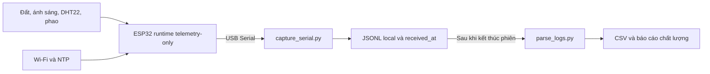
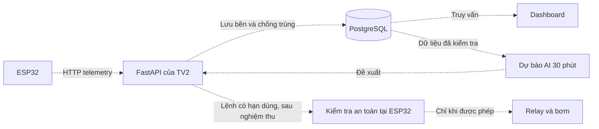
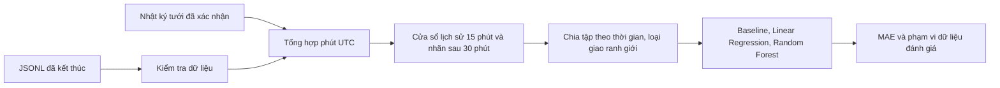

# Kiến trúc Smart-Green

Cập nhật 08/11/2026. Đây là sơ đồ chức năng, không thay thế sơ đồ đấu dây thực tế.

## Đường thu dữ liệu đã chạy thật

Phiên 01 đã xác minh đường trên, gồm 20 mẫu hợp lệ. Việc thu local không cần API TV2. Chưa có bằng chứng telemetry đã được lưu PostgreSQL. Xem [bằng chứng phiên 01](REAL_SESSION_01_2026-11-08.md).

| Hoạt động | Chu kỳ cấu hình | Ý nghĩa |
| --- | --- | --- |
| Đọc cảm biến thông thường | 1 giây | Cập nhật trạng thái tại thiết bị |
| Đọc DHT22 | 2,5 giây | Cập nhật nhiệt độ và độ ẩm không khí |
| In dòng `# live` | 3 giây | Xem nhanh tại Serial; không phải mẫu gửi server |
| Tạo JSON telemetry | 30 giây | Có identity và giờ đo; gửi qua mạng khi cấu hình hợp lệ |

Chu kỳ không phải cam kết độ trễ tuyệt đối. Retry mạng có thể diễn ra giữa hai lần tạo mẫu. `timestamp` là giờ đo UTC, `received_at` do bộ thu ghi khi nhận; giờ nhập database là thời điểm khác. Trước NTP, giờ đo có thể null.

## Đích tích hợp với TV2 — chưa nghiệm thu

Các đường nét đứt là luồng cần tích hợp/kiểm chứng. Hiện bơm khóa và AI không được kích bơm. Server phải ACK sau khi lưu bền; ESP32 vẫn kiểm tra phao, hiệu chuẩn, thời gian và các giới hạn. Mất mạng có thể gây mất mẫu vì queue telemetry hữu hạn; không tuyên bố lưu bù đầy đủ.

## Chuẩn bị dữ liệu AI ngoại tuyến

Không biết giờ tưới thì giữ thiếu, không đoán. Một giờ thu liên tục hữu ích để kiểm tra pipeline nhưng chưa đủ chứng minh mô hình tốt qua nhiều chu kỳ. Kết quả synthetic chỉ chứng minh phần mềm chạy được.

## Phân công

- TV1: thiết bị, telemetry, quy tắc an toàn, dữ liệu và AI, thử nghiệm phần cứng.
- TV2: API, xác thực, PostgreSQL, dashboard.
- Cả hai: thống nhất [hợp đồng API](TV2_CONTRACT.md), đối chiếu dữ liệu lưu và thử mất mạng/phục hồi.
